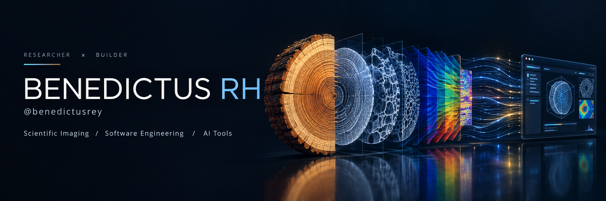
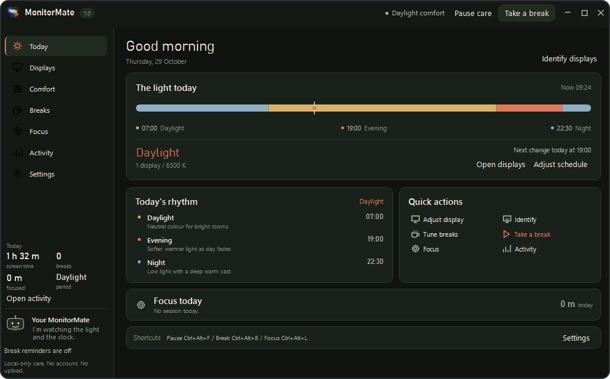
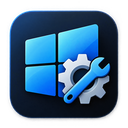
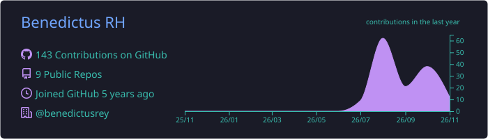
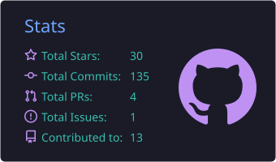
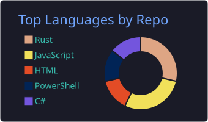
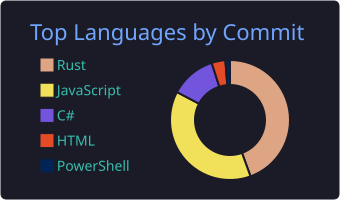
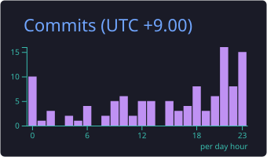
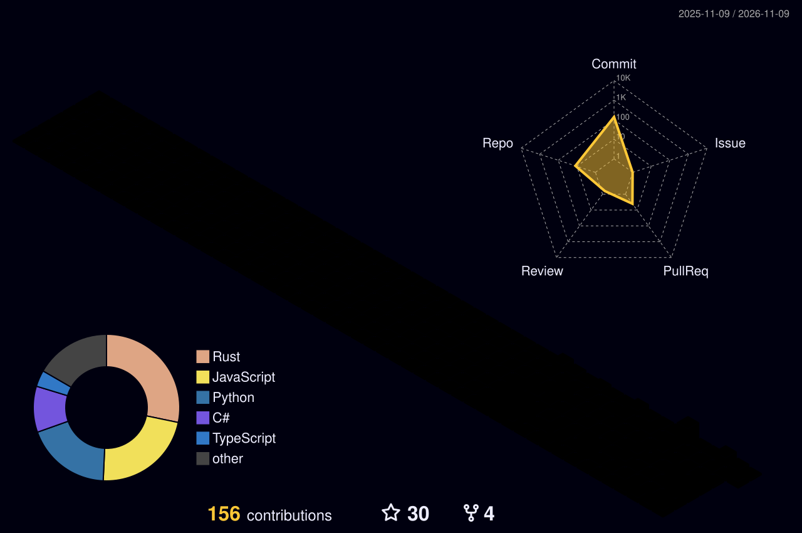

  

# Benedictus RH

I build desktop apps that keep Instagram, WhatsApp, YouTube, TikTok and X in their own windows. I'm also a PhD student in Nagoya, Japan, studying how wood breaks down with hyperspectral imaging, X-ray CT and Python.

**Start with [IG Now](https://github.com/benedictusrey/IG-Now)**, the most-starred app.

## Apps

### Desktop clients

| App | Get it |
| --- | --- |
|  **[IG Now](https://github.com/benedictusrey/IG-Now)** Instagram in its own window, with message notifications and media controls. Windows, macOS, Linux | **[Download](https://github.com/benedictusrey/IG-Now/releases/latest)**   |
|  **[WhatsNow](https://github.com/benedictusrey/WhatsNow-for-WhatsApp)** Several WhatsApp accounts in one window, with App Lock and focus tools. Windows, macOS, Linux | **[Download](https://github.com/benedictusrey/WhatsNow-for-WhatsApp/releases/latest)**   |
|  **[TubeNow](https://github.com/benedictusrey/TubeNow)** YouTube with local ad and tracker filtering and background playback. Windows, macOS, Linux | **[Download](https://github.com/benedictusrey/TubeNow/releases/latest)**   |
|  **[TikTok Now](https://github.com/benedictusrey/TikTok-Now)** TikTok with desktop playback controls, photo carousels and a tray menu. Windows, macOS, Linux | **[Download](https://github.com/benedictusrey/TikTok-Now/releases/latest)**   |
|  **[X-Now](https://github.com/benedictusrey/X-Now)** X in its own window, with tray controls and media saving. Windows, macOS, Linux | **[Download](https://github.com/benedictusrey/X-Now/releases/latest)**   |

### Windows utilities

  
   MonitorMate on Windows

| App | Get it |
| --- | --- |
|  **[Tweak4Windows](https://github.com/benedictusrey/Tweak4Windows)** Reversible Windows tweaks, system inventory and maintenance previews, in one portable app. Windows 10/11, portable zip | **[Download](https://github.com/benedictusrey/Tweak4Windows/releases/latest)**  |
|  **[MonitorMate](https://github.com/benedictusrey/MonitorMate)** Display comfort, break reminders and focus time. Data stays on this PC. Windows x64. Mac and Linux get a reminder preview. | **[Preview build](https://github.com/benedictusrey/MonitorMate/blob/main/docs/INSTALLATION.md)** |

### AI tools

| App | Get it |
| --- | --- |
|  **[Codex-Monitor](https://github.com/benedictusrey/Codex-Monitor)** See Codex reset deadlines, usage runway and token activity at a glance. Windows 10/11, 64-bit, portable zip | **[Download](https://github.com/benedictusrey/Codex-Monitor/releases/latest)**  |
|  **[Antigravity-Monitor](https://github.com/benedictusrey/Antigravity-Monitor)** Know your context and your model limits in Antigravity and VS Code. Needs Node.js 22+ | **[Download](https://github.com/benedictusrey/Antigravity-Monitor/releases/latest)**  |

Found a bug or have an idea for one of these apps? Open an issue on that app's repository. [Browse all repositories](https://github.com/benedictusrey?tab=repositories)

## Activity

Refreshed daily from GitHub.

  

  <table>
    <tr>
      <td></td>
      <td></td>
    </tr>
    <tr>
      <td></td>
      <td></td>
    </tr>
  </table>

### A year of contributions

  

Language stats exclude this profile and the opencodex fork. Public code may not include my research.

Found something useful? Star its repository, or open an issue if something breaks.

  
How this page updates

A GitHub Actions workflow runs once a day. It regenerates the stats cards and the calendar, then commits the result. Built with [Summary Cards](https://github.com/vn7n24fzkq/github-profile-summary-cards), [3D Contrib](https://github.com/yoshi389111/github-profile-3d-contrib) and [Shields.io](https://github.com/badges/shields). The hero banner lives in this repository too, and the workflow does not regenerate it.

The [workflow](.github/workflows/profile-stats.yml) and [Dependabot](.github/dependabot.yml) settings are in this repository. Dependabot checks action updates weekly and opens pull requests for review.

