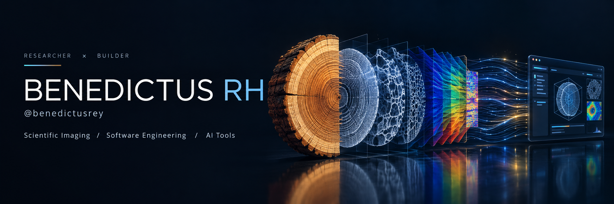
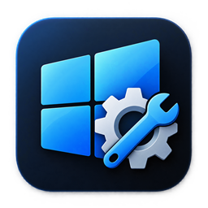

  

# Benedictus RH

I'm Benedictus Reynaldo Hartanto, a PhD student in Nagoya, Japan, studying wood biodegradation with hyperspectral imaging, X-ray CT, and Python.

I also build desktop apps with Rust and Tauri, Windows tools with PowerShell/WPF, and tools for AI coding workflows.

### Pinned apps

Jump to an app below. **Download** opens its latest installers and release notes.

<!-- pinned-projects:start -->

<a href="#user-content-app-benedictusrey-whatsnow-for-whatsapp">WhatsNow</a> &nbsp; <a href="#user-content-app-benedictusrey-tubenow">TubeNow</a> &nbsp; <a href="#user-content-app-benedictusrey-tiktok-now">TikTok&nbsp;Now</a> &nbsp; <a href="#user-content-app-benedictusrey-ig-now">IG&nbsp;Now</a> &nbsp; <a href="#user-content-app-benedictusrey-x-now">X&nbsp;Now</a> &nbsp; <a href="#user-content-app-benedictusrey-tweak4windows">Tweak4Windows</a>

<table width="100%">
<tbody>
<tr>
<td width="1000"><h3><a href="https://github.com/benedictusrey/WhatsNow-for-WhatsApp">&nbsp; WhatsNow</a></h3>

Keep multiple WhatsApp accounts in one focused desktop workspace. Named accounts, Focus sessions, themes, and App Lock.

Available for Windows, macOS, Linux.

 &nbsp;  &nbsp; 
</td>
</tr>
<tr>
<td width="1000"><h3><a href="https://github.com/benedictusrey/TubeNow">&nbsp; TubeNow</a></h3>

Watch YouTube in a dedicated desktop app. Local ad and tracker filtering, fullscreen controls, and background playback.

Available for Windows, macOS, Linux.

 &nbsp;  &nbsp; 
</td>
</tr>
<tr>
<td width="1000"><h3><a href="https://github.com/benedictusrey/TikTok-Now">&nbsp; TikTok Now</a></h3>

Browse TikTok with desktop playback controls. Pause on minimize, photo carousels, and a system tray menu.

Available for Windows, macOS, Linux.

 &nbsp;  &nbsp; 
</td>
</tr>
<tr>
<td width="1000"><h3><a href="https://github.com/benedictusrey/IG-Now">&nbsp; IG Now</a></h3>

Keep Instagram messages and media in their own desktop window. Message notifications, video seeking, and volume controls.

Available for Windows, macOS, Linux.

 &nbsp;  &nbsp; 
</td>
</tr>
<tr>
<td width="1000"><h3><a href="https://github.com/benedictusrey/X-Now">&nbsp; X Now</a></h3>

Use X in a dedicated desktop window. Tray controls, media saving, and themes that follow your system.

Available for Windows, macOS, Linux.

 &nbsp;  &nbsp; 
</td>
</tr>
<tr>
<td width="1000"><h3><a href="https://github.com/benedictusrey/Tweak4Windows">&nbsp; Tweak4Windows</a></h3>

Review and adjust Windows from one portable toolkit. Reversible settings, hardware information, and maintenance previews.

Available for Windows.

 &nbsp;  &nbsp; 
</td>
</tr>
</tbody></table>
<!-- pinned-projects:end -->

Star counts update through GitHub data. Open a repository to star the project or send feedback. If an app helps you, a star helps others find it.

  
Contribution activity and language stats

### GitHub progress

  

  
  

### A year of contributions, in 3D

  

Stats and calendar refresh daily. They reflect GitHub activity; each tool uses its own counting window.

  
Tools & automatic updates

[Summary Cards](https://github.com/vn7n24fzkq/github-profile-summary-cards) · [3D Contrib](https://github.com/yoshi389111/github-profile-3d-contrib) · [Shields.io](https://github.com/badges/shields)

The [daily workflow](.github/workflows/profile-stats.yml) keeps this table in sync with public pinned repositories, in pin order. Release and star badges update through Shields.io and may be cached briefly. Cards and calendar are stored in this repository. Language cards exclude this profile and the opencodex fork; public code may not include my research.

The supplied banner is stored in this repository and needs no scheduled refresh.

Generator versions are pinned. [Dependabot](.github/dependabot.yml) checks weekly for action updates and proposes pull requests for review.

