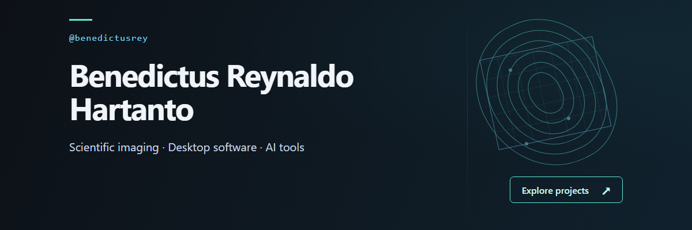
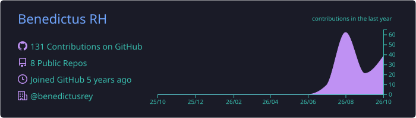
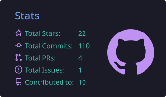
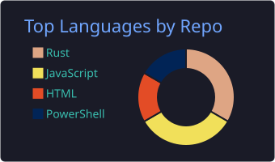
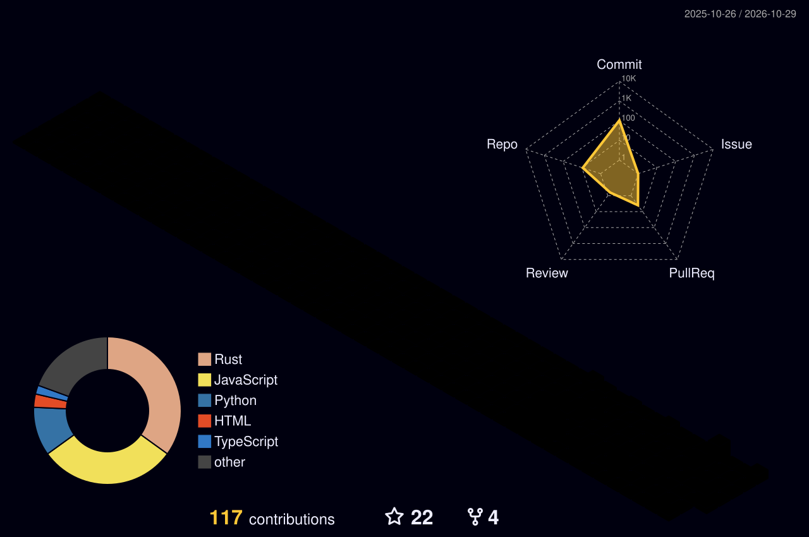

  <a href="#selected-projects">
    <picture>
      <source media="(max-width: 600px)" srcset="assets/banners/profile/geometric-600x320.png" />
      
    </picture>
  </a>

I'm **Benedictus Reynaldo Hartanto** ([@benedictusrey](https://github.com/benedictusrey)), a **PhD student in Nagoya, Japan**, studying wood biodegradation through **hyperspectral imaging, X-ray CT, and Python**.

Alongside research, I build desktop software for everyday use: **Rust/Tauri applications**, **Windows utilities with PowerShell/WPF**, and tools for **AI coding workflows**.

### Selected projects

| Project | What it does | Latest release |
| :--- | :--- | :--- |
| **[Tweak4Windows](https://github.com/benedictusrey/Tweak4Windows)** | Portable Windows 10/11 toolkit for reversible settings, hardware information, and maintenance previews. |  |
| **[WhatsNow](https://github.com/benedictusrey/WhatsNow-for-WhatsApp)** | WhatsApp Web workspace with multiple accounts, quiet Focus sessions, themes, and App Lock. |  |
| **[TubeNow](https://github.com/benedictusrey/TubeNow)** | YouTube desktop app with local ad/tracker filtering, fullscreen controls, and background playback. |  |
| **[IG Now](https://github.com/benedictusrey/IG-Now)** | Instagram desktop client with message notifications and media controls, built with Rust and Tauri. |  |
| **[Codex Monitor](https://github.com/benedictusrey/Codex-Monitor)** | Windows dashboard for Codex usage, reset deadlines, token activity, and model runway. |  |

More desktop projects: [X Now](https://github.com/benedictusrey/X-Now) · [TikTok Now](https://github.com/benedictusrey/TikTok-Now)

Explore each repository or download a release above. **Feedback, feature ideas, and contributions are welcome** through each project's issues and contributing guide.

### GitHub progress

  

  
  

### A year of contributions, in 3D

  

Stats and calendar refresh daily. They reflect GitHub activity; each tool uses its own counting window.

  
Tools & automatic updates

[Summary Cards](https://github.com/vn7n24fzkq/github-profile-summary-cards) · [3D Contrib](https://github.com/yoshi389111/github-profile-3d-contrib) · [Shields.io](https://github.com/badges/shields)

Cards and calendar are stored in this repository and regenerated by the [daily workflow](.github/workflows/profile-stats.yml). Release badges update through Shields.io. Language cards exclude this profile and the opencodex fork; public code may not include my research.

The static banner is stored here alongside its [editable designs](assets/banners/profile). It needs no scheduled refresh.

Generator versions are pinned. [Dependabot](.github/dependabot.yml) checks weekly for action updates and proposes pull requests for review.

