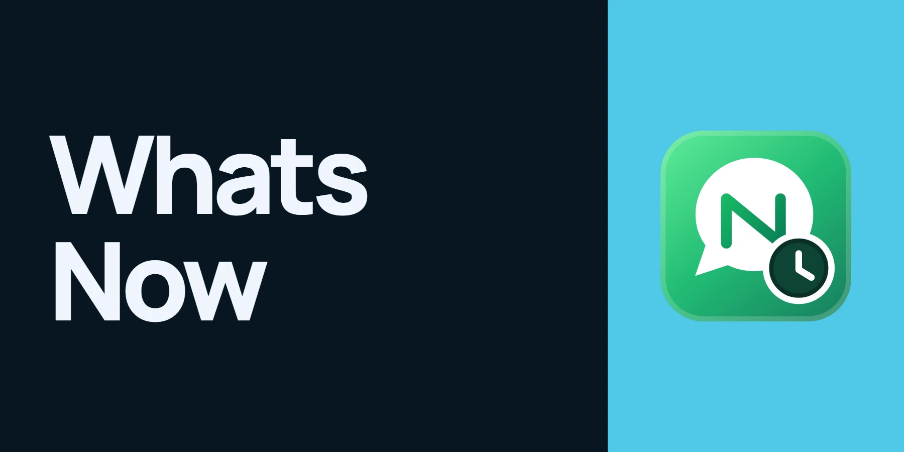

  

# Benedictus RH

I’m Benedictus Reynaldo Hartanto, a PhD student in Nagoya, Japan. I study wood biodegradation with hyperspectral imaging, X-ray CT, and Python, and build desktop software alongside my research.

**[Explore the projects](#user-content-pinned-apps)**

## Pinned apps

Messaging, video, social media, and Windows tools. Ordered by GitHub stars, refreshed daily.

<!-- pinned-projects:start -->

<a href="#user-content-ig-now">IG&nbsp;Now</a> &nbsp; <a href="#user-content-whatsnow">WhatsNow</a> &nbsp; <a href="#user-content-tubenow">TubeNow</a> &nbsp; <a href="#user-content-tiktok-now">TikTok&nbsp;Now</a> &nbsp; <a href="#user-content-x-now">X&nbsp;Now</a> &nbsp; <a href="#user-content-tweak4windows">Tweak4Windows</a>

<h3><a href="https://github.com/benedictusrey/IG-Now">IG Now</a></h3>

<strong>Keep Instagram messages and media in their own desktop window.</strong> Message notifications, video seeking, and volume controls.

<a href="https://github.com/benedictusrey/IG-Now/releases/tag/v2.2.0">Release <strong>v2.2.0</strong></a> · Available for Windows, macOS, Linux. &nbsp; 

<a href="https://github.com/benedictusrey/IG-Now"><strong>Explore project</strong></a> &nbsp; <a href="https://github.com/benedictusrey/IG-Now/releases/latest">Download latest</a>

<h3><a href="https://github.com/benedictusrey/WhatsNow-for-WhatsApp">WhatsNow</a></h3>

<strong>Keep multiple WhatsApp accounts in one focused desktop workspace.</strong> Named accounts, Focus sessions, themes, and App Lock.

<a href="https://github.com/benedictusrey/WhatsNow-for-WhatsApp/releases/tag/v2.6.2">Release <strong>v2.6.2</strong></a> · Available for Windows, macOS, Linux. &nbsp; 

<a href="https://github.com/benedictusrey/WhatsNow-for-WhatsApp"><strong>Explore project</strong></a> &nbsp; <a href="https://github.com/benedictusrey/WhatsNow-for-WhatsApp/releases/latest">Download latest</a>

## More pinned projects

<h3><a href="https://github.com/benedictusrey/TubeNow">TubeNow</a></h3>

<strong>Watch YouTube in a dedicated desktop app.</strong> Local ad and tracker filtering, fullscreen controls, and background playback.

<a href="https://github.com/benedictusrey/TubeNow/releases/tag/v1.1.2">Release <strong>v1.1.2</strong></a> · Available for Windows, macOS, Linux. &nbsp; 

<a href="https://github.com/benedictusrey/TubeNow"><strong>Explore project</strong></a> &nbsp; <a href="https://github.com/benedictusrey/TubeNow/releases/latest">Download latest</a>

<h3><a href="https://github.com/benedictusrey/TikTok-Now">TikTok Now</a></h3>

<strong>Browse TikTok with desktop playback controls.</strong> Pause on minimize, photo carousels, and a system tray menu.

<a href="https://github.com/benedictusrey/TikTok-Now/releases/tag/v2.1.0">Release <strong>v2.1.0</strong></a> · Available for Windows, macOS, Linux. &nbsp; 

<a href="https://github.com/benedictusrey/TikTok-Now"><strong>Explore project</strong></a> &nbsp; <a href="https://github.com/benedictusrey/TikTok-Now/releases/latest">Download latest</a>

<h3><a href="https://github.com/benedictusrey/X-Now">X Now</a></h3>

<strong>Use X in a dedicated desktop window.</strong> Tray controls, media saving, and themes that follow your system.

<a href="https://github.com/benedictusrey/X-Now/releases/tag/v2.1.0">Release <strong>v2.1.0</strong></a> · Available for Windows, macOS, Linux. &nbsp; 

<a href="https://github.com/benedictusrey/X-Now"><strong>Explore project</strong></a> &nbsp; <a href="https://github.com/benedictusrey/X-Now/releases/latest">Download latest</a>

<h3><a href="https://github.com/benedictusrey/Tweak4Windows">Tweak4Windows</a></h3>

<strong>Review and adjust Windows from one portable toolkit.</strong> Reversible settings, hardware information, and maintenance previews.

<a href="https://github.com/benedictusrey/Tweak4Windows/releases/tag/v1.0.0">Release <strong>v1.0.0</strong></a> · Available for Windows. &nbsp; 

<a href="https://github.com/benedictusrey/Tweak4Windows"><strong>Explore project</strong></a> &nbsp; <a href="https://github.com/benedictusrey/Tweak4Windows/releases/latest">Download latest</a>

<!-- pinned-projects:end -->

## Activity and updates

Found something useful? Star its repository or share feedback through its issues.

  
Contribution activity and language stats

### GitHub progress

  

  
  

### A year of contributions, in 3D

  

Stats and calendar refresh daily. They reflect GitHub activity; each tool uses its own counting window.

  
Tools & automatic updates

[Summary Cards](https://github.com/vn7n24fzkq/github-profile-summary-cards) · [3D Contrib](https://github.com/yoshi389111/github-profile-3d-contrib) · [Shields.io](https://github.com/badges/shields)

The [daily workflow](.github/workflows/profile-stats.yml) ranks public pinned projects by their current stars and features the leading two. Ties keep the original pin order. Refreshes are scheduled for 06:23 Asia/Jayapura; GitHub may queue them later. Star badges update through Shields.io and can briefly differ from the daily ordering.

**Explore project** opens source and documentation; **Download latest** opens the published installers and release notes. Covers use the original app marks and are stored here, with no scheduled artwork generation.

Cards and calendar are stored in this repository. Language cards exclude this profile and the opencodex fork; public code may not include my research.

The supplied banner is stored in this repository and needs no scheduled refresh.

Generator versions are pinned. [Dependabot](.github/dependabot.yml) checks weekly for action updates and proposes pull requests for review.

**[Browse all repositories](https://github.com/benedictusrey?tab=repositories)**
