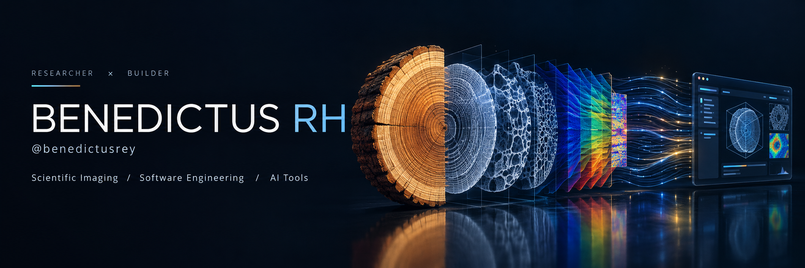
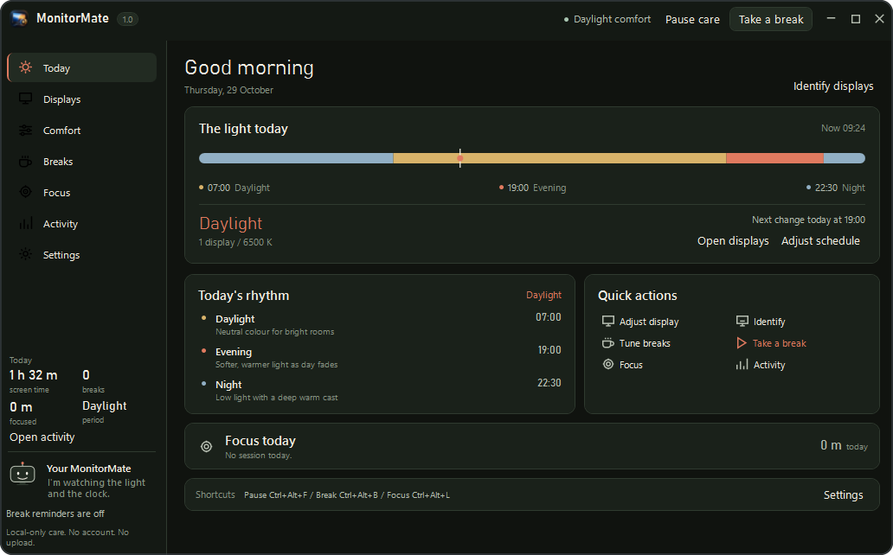
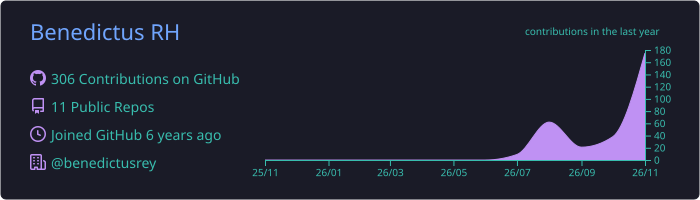
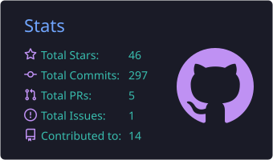
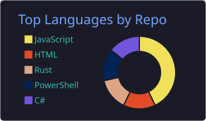
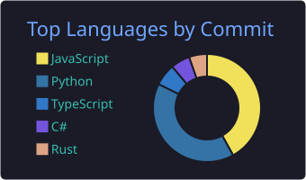
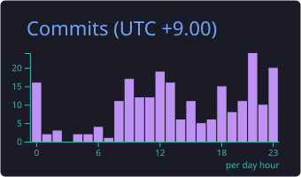
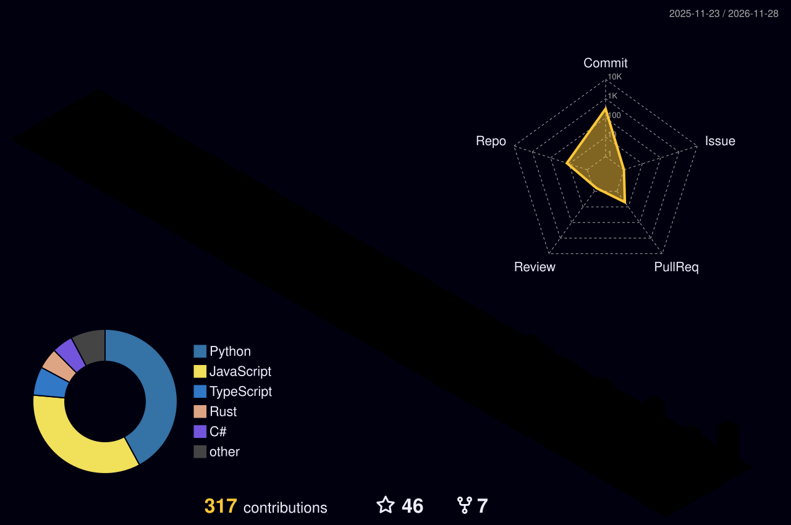

  

# Benedictus RH

I build desktop apps that keep Instagram, WhatsApp, YouTube, TikTok and X in their own windows. I'm also a PhD student in Nagoya, Japan, studying how wood breaks down with hyperspectral imaging, X-ray CT and Python.

**Start with [IG Now](https://github.com/benedictusrey/IG-Now)**, the most-starred app.

## Apps

### Desktop clients

<table>
<thead>
<tr>
<th align="left" width="715">App</th>
<th align="left" width="130">Get it</th>
</tr>
</thead>
<tbody>
<tr>
<td> <a href="https://github.com/benedictusrey/IG-Now"><strong>IG Now</strong></a> Instagram in its own window, with message notifications and media controls. Windows, macOS, Linux</td>
<td><a href="https://github.com/benedictusrey/IG-Now/releases/latest"><strong>Download</strong></a>  </td>
</tr>
<tr>
<td> <a href="https://github.com/benedictusrey/TikTok-Now"><strong>TikTok Now</strong></a> TikTok with desktop playback controls, photo carousels and a tray menu. Windows, macOS, Linux</td>
<td><a href="https://github.com/benedictusrey/TikTok-Now/releases/latest"><strong>Download</strong></a>  </td>
</tr>
<tr>
<td> <a href="https://github.com/benedictusrey/WhatsNow-for-WhatsApp"><strong>WhatsNow</strong></a> Several WhatsApp accounts in one window, with App Lock and focus tools. Windows, macOS, Linux</td>
<td><a href="https://github.com/benedictusrey/WhatsNow-for-WhatsApp/releases/latest"><strong>Download</strong></a>  </td>
</tr>
<tr>
<td> <a href="https://github.com/benedictusrey/X-Now"><strong>X-Now</strong></a> X in its own window, with tray controls and media saving. Windows, macOS, Linux</td>
<td><a href="https://github.com/benedictusrey/X-Now/releases/latest"><strong>Download</strong></a>  </td>
</tr>
<tr>
<td> <a href="https://github.com/benedictusrey/TubeNow"><strong>TubeNow</strong></a> YouTube with local ad and tracker filtering and background playback. Windows, macOS, Linux</td>
<td><a href="https://github.com/benedictusrey/TubeNow/releases/latest"><strong>Download</strong></a>  </td>
</tr>
</tbody>
</table>

### AI tools

<table>
<thead>
<tr>
<th align="left" width="715">App</th>
<th align="left" width="130">Get it</th>
</tr>
</thead>
<tbody>
<tr>
<td> <a href="https://github.com/benedictusrey/Antigravity-Monitor"><strong>Antigravity-Monitor</strong></a> Know your context and your model limits in Antigravity and VS Code. Needs Node.js 22+</td>
<td><a href="https://github.com/benedictusrey/Antigravity-Monitor/releases/latest"><strong>Download</strong></a>  </td>
</tr>
</tbody>
</table>

### Windows utilities

  
   MonitorMate on Windows

<table>
<thead>
<tr>
<th align="left" width="715">App</th>
<th align="left" width="130">Get it</th>
</tr>
</thead>
<tbody>
<tr>
<td> <a href="https://github.com/benedictusrey/MonitorMate"><strong>MonitorMate</strong></a> Display comfort, break reminders and focus time. Data stays on this PC. Windows x64. Mac and Linux get a reminder preview.</td>
<td><a href="https://github.com/benedictusrey/MonitorMate/blob/main/docs/INSTALLATION.md"><strong>Preview build</strong></a> </td>
</tr>
<tr>
<td> <a href="https://github.com/benedictusrey/Tweak4Windows"><strong>Tweak4Windows</strong></a> Reversible Windows tweaks, system inventory and maintenance previews, in one portable app. Windows 10/11, portable zip</td>
<td><a href="https://github.com/benedictusrey/Tweak4Windows/releases/latest"><strong>Download</strong></a>  </td>
</tr>
</tbody>
</table>

Found a bug or have an idea for one of these apps? Open an issue on that app's repository. [Browse all repositories](https://github.com/benedictusrey?tab=repositories)

## Research

Software from my research on wood micro-CT scans.

  
   cleanCT on a micro-CT wood scan

<table>
<thead>
<tr>
<th align="left" width="715">App</th>
<th align="left" width="130">Get it</th>
</tr>
</thead>
<tbody>
<tr>
<td> <a href="https://github.com/benedictusrey/cleanCT"><strong>cleanCT</strong></a> Removes the metal base from micro-CT wood scans without changing the source scan, then exports the inner wood region as DICOM and NIfTI. Windows, Linux. NVIDIA GPU optional.</td>
<td><a href="https://github.com/benedictusrey/cleanCT/releases/latest"><strong>Download</strong></a>  </td>
</tr>
</tbody>
</table>

## Activity

Refreshed daily from GitHub.

  

  <table>
    <tr>
      <td></td>
      <td></td>
    </tr>
    <tr>
      <td></td>
      <td></td>
    </tr>
  </table>

### A year of contributions

  

Language stats exclude this profile and the opencodex fork. Public code may not include my research.

Found something useful? Star its repository, or open an issue if something breaks.

  
How this page updates

A GitHub Actions workflow runs once a day. It regenerates the stats cards and the calendar, then commits the result. Built with [Summary Cards](https://github.com/vn7n24fzkq/github-profile-summary-cards), [3D Contrib](https://github.com/yoshi389111/github-profile-3d-contrib) and [Shields.io](https://github.com/badges/shields). The hero banner lives in this repository too, and the workflow does not regenerate it.

The [workflow](.github/workflows/profile-stats.yml) and [Dependabot](.github/dependabot.yml) settings are in this repository. Dependabot checks action updates weekly and opens pull requests for review.

